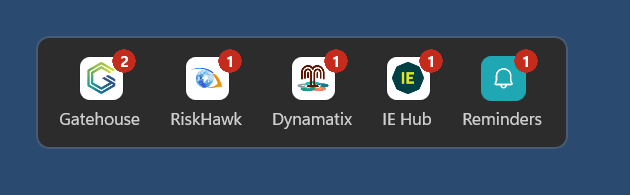
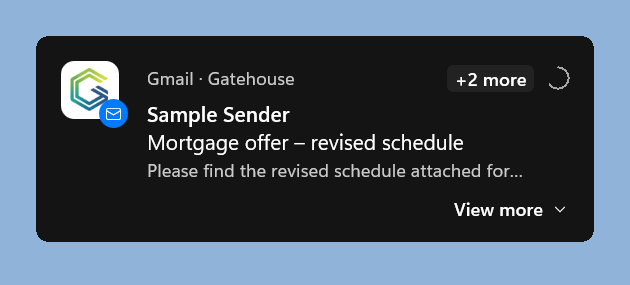
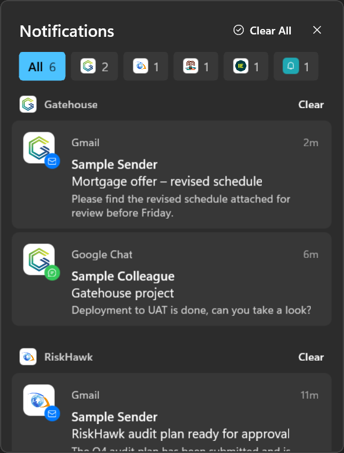
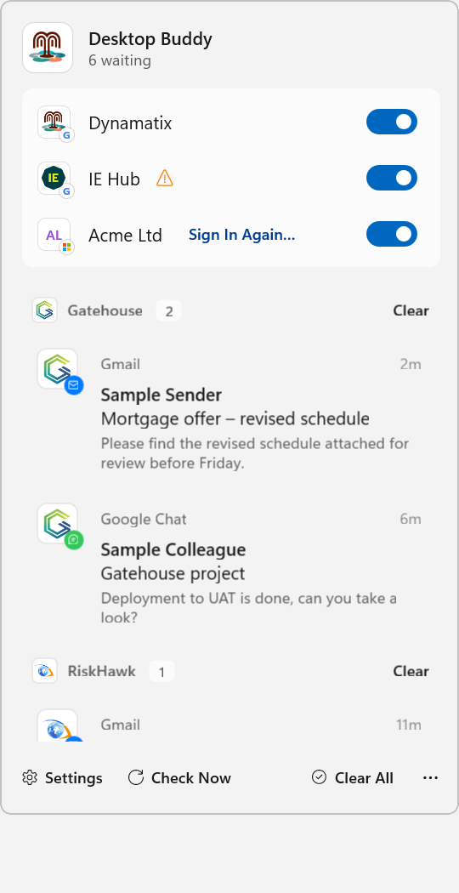
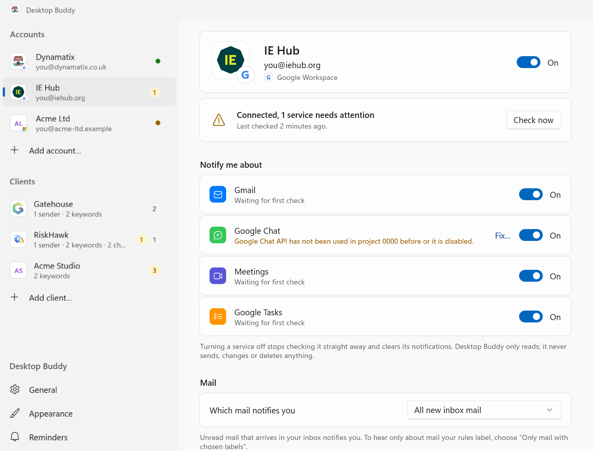

# Desktop Buddy for Windows

The Windows version of Desktop Buddy: the same read-only notifications for Google Workspace and Microsoft 365, the same Clients, rules and privacy promises as the Mac app, designed for Windows 11.

**Status:** in development on the `feature/windows-app` branch. Not released yet. See [What's left](#whats-left).

<p>
&nbsp;&nbsp;

</p>
<p>
&nbsp;&nbsp;

</p>


Screenshots use sample data (`DesktopBuddy.exe --snapshot`).

## How it maps to the Mac app

| Mac | Windows |
|---|---|
| Menu bar bell and dropdown | Tray icon (notification area) and its flyout |
| Dock of logos, menu bar pop-up | Floating acrylic dock of logos, top pop-up |
| Keychain | Windows Credential Manager (`DesktopBuddy/…` entries) |
| `~/Library/Application Support/DesktopBuddyV2/` | `%LOCALAPPDATA%\DesktopBuddy\` |
| Login item | "Open at sign-in" (the `HKCU\…\Run` key) |
| System Settings–style window | Windows Settings–style window |
| `--selftest` (231 checks) | xUnit tests (`tests/`) plus `DesktopBuddy.exe --selftest` for the Windows-only parts |
| DMG | A zip with a `Desktop Buddy` folder (see [Releasing](#releasing)) |

The settings file (`config.json`) uses the same format on both platforms.

## Project layout

| Path | What it is |
|---|---|
| `src/DesktopBuddy.Core/` | Everything that isn't UI, in plain .NET with no third-party packages: models, client rules, inbox, poller, sign-in (OAuth with PKCE), Google and Microsoft sources, update check. Each file names the Swift file it ports. |
| `src/DesktopBuddy.App/` | The WinUI 3 app: tray icon, windows, Credential Manager, screenshots mode |
| `tests/DesktopBuddy.Tests/` | The port of the Mac self-test, plus sign-in and API parsing tests |
| `build-windows.ps1` | Test, build, check, package, install |
| `tools/make-icon.py` | Rebuilds `AppIcon.ico` from the Dynamatix logo |

## Build and run

Needs the [.NET 10 SDK](https://dotnet.microsoft.com/download). Visual Studio isn't needed.

```powershell
.\build-windows.ps1 -Install
```

That runs every test, builds a self-contained copy, runs the Windows checks, installs it to `%LOCALAPPDATA%\Programs\Desktop Buddy`, adds it to the Start menu and opens it.

| Command | Result |
|---|---|
| `.\build-windows.ps1` | Test and build only |
| `.\build-windows.ps1 -Install` | Also install for this user and open it |
| `.\build-windows.ps1 -Share` | Also make `dist\Desktop-Buddy-Windows-x64.zip` and its `.sha256` |
| `.\build-windows.ps1 -Arch arm64` | Build for Windows on ARM |

While developing:

```powershell
dotnet test DesktopBuddy.slnx
dotnet build src/DesktopBuddy.App
src\DesktopBuddy.App\bin\Debug\net10.0-windows10.0.22621.0\win-x64\DesktopBuddy.exe --snapshot C:\temp\shots
```

`--snapshot <folder>` renders every screen with sample data, in light and dark mode, to PNG files, then quits. Add `--only <name>` for one screen. It uses a throwaway data folder and never touches your real sign-ins.

## Sign-in setup (`team.json`)

Put `team.json` in this `windows` folder before building. It's git-ignored and built into the app.

- **Google:** Windows can't use the Mac's iOS-type client. Create a second OAuth client in the same Google Cloud project, of type **Desktop app**, and put its client ID and secret in `team.json` (`googleClientID`, `googleClientSecret`). Google documents a Desktop client's secret as not confidential, but keep `team.json` out of the repository anyway. Sign-in uses the loopback redirect `http://127.0.0.1:<port>` with PKCE.
- **Microsoft:** the same Entra app as the Mac (public client, `http://localhost` redirect). Nothing changes.

## Releasing

1. Raise `<Version>` in `Directory.Build.props` to match the Mac version.
2. Put `team.json` in this folder and run `.\build-windows.ps1 -Share`.
3. Attach `dist\Desktop-Buddy-Windows-x64.zip` and `dist\Desktop-Buddy-Windows-x64.zip.sha256` to the same GitHub release as the Mac DMG. Each app only reads its own files.

Until the app is code-signed, Windows shows "Windows protected your PC" the first time: click **More info → Run anyway**.

## What's left

- Install updates in place ("Update and Restart"). For now the app checks for updates and links to the download.
- Code signing (Azure Trusted Signing or a certificate), then an installer.
- A live test with real Google and Microsoft accounts once the Desktop-type Google client exists.
